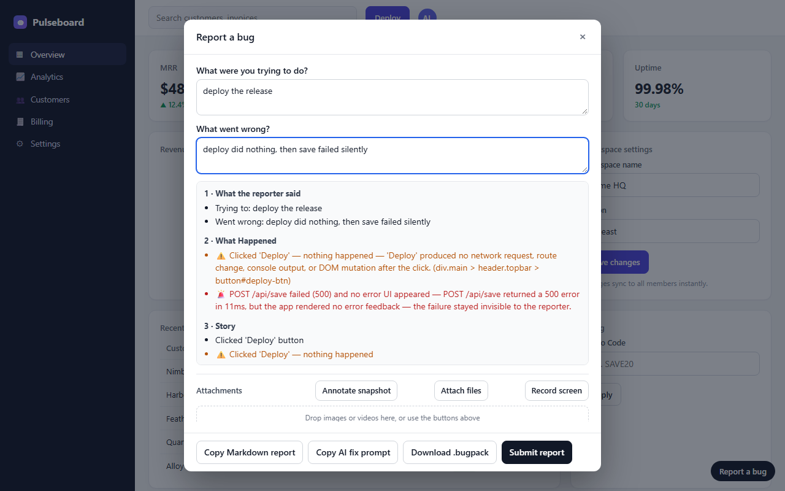
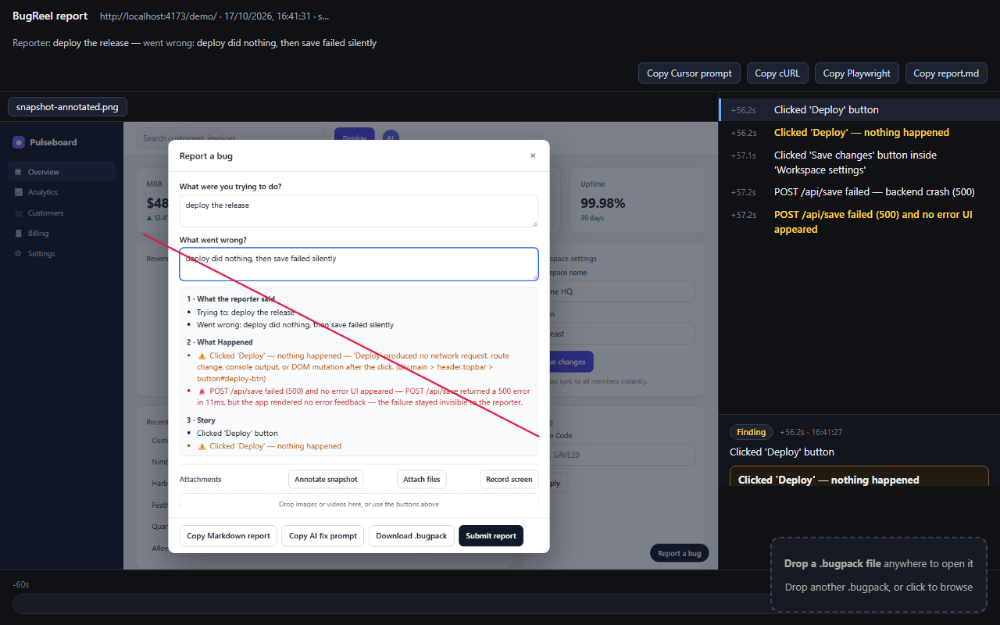
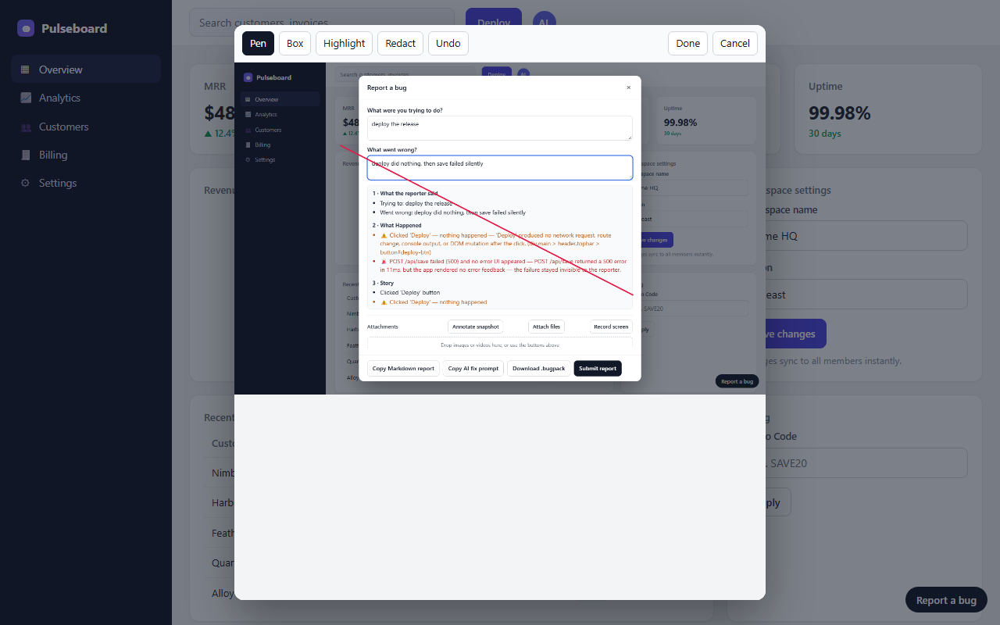
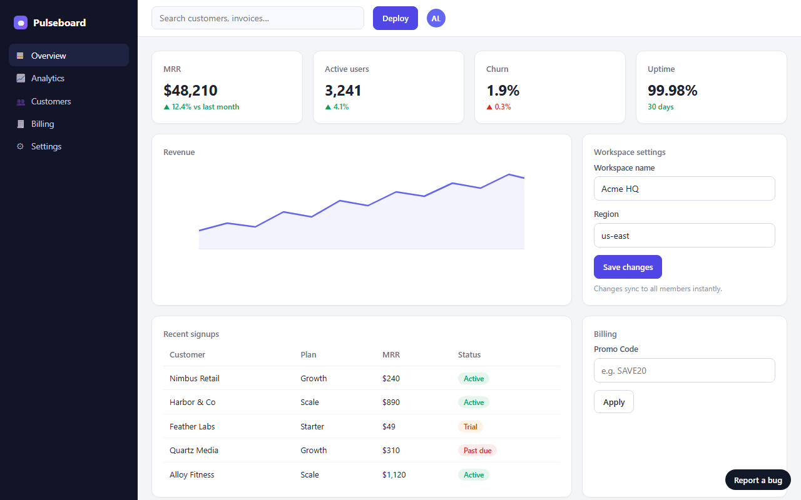

# BugReel

**Bug reports that actually explain the bug.** A reporter clicks "Report a
bug", answers two questions, and the developer gets a complete report — what
they did, what broke, every click and network call from the last ~60 seconds —
instead of "it doesn't work".

No AI. No session replay video. No cookies or analytics. The same events in
always produce the same report out.



## Why it's different

Most bug reports stop at "the button doesn't work". BugReel watches quietly in
the background and spots the three failures humans can't describe:

- **Dead Click** — they clicked, and literally nothing happened
- **Silent Failure** — the API errored but the app showed no error
- **Rage Click** — they clicked the same thing 3+ times in frustration

The report arrives already translated to plain English:
`Clicked 'Deploy' — nothing happened — 'Deploy' produced no network request,
route change, console output, or DOM mutation after the click.`

## Install (30 seconds)

**Script tag — any site, no build step:**

```html
<script
  src="https://cdn.jsdelivr.net/npm/@bugreel/sdk@0.1.0/dist/loader.global.js"
  data-bugreel-app="my-app"
></script>
```

That's it. A "Report a bug" pill appears in the corner and the recorder is live.

**npm — React/Vue/Svelte/bundler apps:**

```bash
npm install @bugreel/sdk
```

```ts
import { initBugReel } from '@bugreel/sdk';

initBugReel({
  app: 'my-app',
  pill: true,               // floating "Report a bug" button
  webhookUrl: 'https://…',  // optional — post reports to Discord/Slack/any URL
});
```

## What a developer gets

Every report is a self-contained `.bugpack` file (it's just a ZIP) containing:

- **The story** — every click, input, page change, API call, and console error
  from the last ~60 seconds, in readable sentences with timestamps
- **The findings** — dead clicks, silent failures, rage clicks, each explained
- **What the reporter said** — the two required questions: "what were you
  trying to do?" and "what went wrong?"
- **Attachments** — annotated screenshot, extra files, a 15-second screen
  recording
- **Ready-made tools** — a Markdown report, a `curl` command to replay the
  failing API call, a runnable Playwright script, and a fix-prompt you can
  paste into Cursor/Claude

Open any `.bugpack` in the standalone player — drag the file onto
`player.html` and scrub the timeline:



## Annotate the screenshot before sending

Reporters can mark up the snapshot — pen, box, highlight, **redact** (pixelate)
— before it leaves their browser:



## Try it now — the demo is a real app with real bugs

```bash
pnpm install && pnpm setup:e2e && pnpm demo
```

Open http://localhost:4173/demo/ — a fake dashboard with 5 planted bugs. Click
**Deploy** (does nothing — dead click), **Save changes** (500 with no error UI
— silent failure), mash **Sync now** (rage click), then open the pill and watch
BugReel catch all of them.

Don't want to run it? Drop [`docs/screenshots/sample.bugpack`](docs/screenshots/sample.bugpack)
into `packages/player/player.html` — it's a real report from the demo.



## How it works

1. A **<4KB loader** (gzipped) injects a tiny script. It lazily loads the
   recorder, which runs in a Web Worker off the main thread.
2. The worker keeps a rolling ~60-second buffer of clicks, inputs, routes,
   network calls, console output, and crashes.
3. When the reporter opens the modal (pill, `Ctrl+Shift+B`, shake on mobile, or
   `window.BugReel.open()`), the worker compiles the buffer into the report —
   all in the browser, nothing leaves until they hit Submit.

## Privacy — nothing secret leaves the page

Two independent scrubbing stages run before anything is stored or sent:

- Inputs marked `type="password"`, `hidden`, or `file` never record anything —
  not even a click count. Credit-card, OTP, and password-style fields
  (`autocomplete`, names like `secret`/`token`/`apikey`) are skipped.
- Auth headers, JWTs, card numbers, and secret-prefixed strings are scrubbed
  from the raw event data itself.
- You control the rest declaratively:

| Add this to an element | Result |
|---|---|
| `data-bugreel="mask"` or `data-sensitive` | No events, removed from screenshots |
| `data-bugreel-block` | Kept out of screenshots (events still work) |
| `data-bugreel="allow"` | Overrides the field-name rule (never a masked region or password field) |
| `data-bugreel-privacy="strict"` on the script tag | Input values report as length counts, never content |

BugReel never records its own UI — clicking inside the report modal can't leak
into the report.

## Sending reports (Mode 2)

Point the `webhookUrl` at where reports should land:

| Endpoint | What arrives |
|---|---|
| Discord webhook | Rich embed + the `.bugpack` file (auto-shrinks past 7.5MB) |
| Slack webhook | Block Kit message; the `.bugpack` downloads for the reporter |
| Any other URL | Multipart form with `report` (JSON) + `bugpack` (file) |

No webhook? Mode 1 (default) saves reports in the browser's IndexedDB and lets
reporters copy the Markdown or download the `.bugpack` to send you directly.

## Configuration

All script-tag options use `data-bugreel-*`; npm options match by name:

| Option | Purpose |
|---|---|
| `app` / `project` | Shown in the report header |
| `webhook` (script) / `webhookUrl` (npm) | Mode-2 destination URL |
| `pill` | `true`/`false`/`auto` — floating button (npm `auto` = dev builds only) |
| `hotkey` | e.g. `ctrl+shift+b` (the default) |
| `shake` | `true` — shake-to-report on mobile |
| `privacy` | `standard` (default) / `strict` |
| `worker-url` | Custom worker chunk URL (CSP escape hatch) |
| `user` | npm only — reporter identity object |

## What's deliberately not here

- **No AI** — findings come from deterministic rules you can audit in
  `packages/sdk/src/worker/detectors/`. Reports state observed facts only.
- **No DOM replay** — BugReel keeps an event log, not a video of the page.
  Snapshots happen only when a reporter annotates.
- **No auto-open** — reports only happen when a human triggers one
  (ADR-0007). It never fires itself.

## Repo map

- `packages/sdk` — the SDK (`loader` + `capture` + `worker` + `modal` chunks)
- `packages/player` — `<bugreel-player>` element + standalone `player.html`
- `packages/server` — Phase-2 backend scaffold (private, types only)
- `demo/` — the deliberately-broken demo app
- `e2e/` — Playwright tests driving the real built SDK in Chromium
- `docs/adr/` — the locked design decisions; `GLOSSARY.md` — shared vocabulary

## Develop

```bash
pnpm install
pnpm setup:e2e    # one-time Playwright browser download
pnpm test         # build + unit + e2e
pnpm size-check   # loader must stay < 3.5KB gzipped
pnpm demo         # demo at http://localhost:4173/demo/
```

CI runs the same gates on every push: build → typecheck → size-check →
373 unit tests → 26 Playwright e2e tests.

## Release

```bash
pnpm -r publish --access public
```

`@bugreel/sdk` and `@bugreel/player` are published at `0.1.0`. The `.bugpack`
format and `report.json` schema v1.0 are frozen — Phase 2 (self-hosted console)
builds on them.

> v0.1.0 — early but tested. Spec: issue #1. Design: `docs/adr/`.
